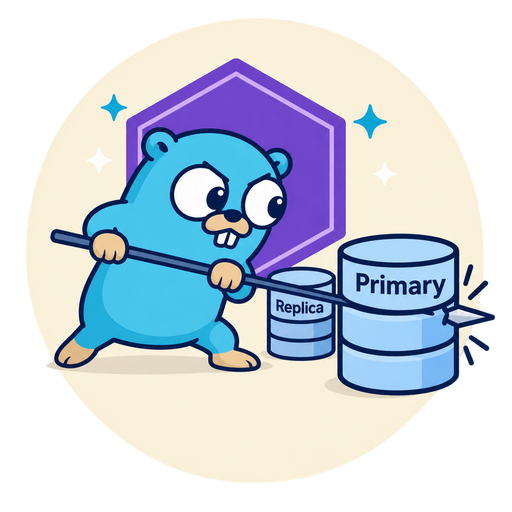

<div align="center">



# dbstick

Read your own writes with a replica database, even on the next request.

[](https://github.com/mpyw/dbstick/actions/workflows/test.yml)
[](https://codecov.io/gh/mpyw/dbstick)
[](https://pkg.go.dev/github.com/mpyw/dbstick)

</div>

A user submits a form and is redirected to the result. The read runs on a replica that has not caught up yet, so the user sees the old data.

dbstick fixes this. When a user writes, it stores their key in a shared store, such as Redis. For the next few seconds, that user's reads go to the primary. Other users keep reading from the replica.

It is a Go port of [mpyw/laravel-cached-database-stickiness](https://github.com/mpyw/laravel-cached-database-stickiness).

## Install

```sh
go get github.com/mpyw/dbstick
go get github.com/mpyw/dbstick/redisstore
```

Then add the hook for your driver. The hook sees each write on the primary and records it. Each hook's README says how to set it up.

| Driver | Hook |
| --- | --- |
| pgx, or `database/sql` with pgx | [pgxstick](pgxstick/README.md) |
| Any other `database/sql` driver | [sqlstick](sqlstick/README.md) |
| GORM | [gormstick](gormstick/README.md), plus one of the above |

## Usage

Make a Tracker, open the primary with your driver's hook, and give both handles to a Router. Each hook's README shows how to open the primary.

```go
tracker := dbstick.NewTracker(
	store,
	auth.UserID, // func(ctx) string
)

// primary has the hook. replica does not.
db := dbstick.NewRouter(tracker, primary, replica)

http.ListenAndServe(
	":8080",
	tracker.Middleware(mux),
)
```

In a handler, pick the handle with `ForWrite` or `ForRead`:

```go
// Returns the primary.
// Its hook records each write.
db.ForWrite()

// Returns the primary if this user wrote recently.
// Returns the replica otherwise.
db.ForRead(ctx)
```

`Router` returns the handles you gave it, and does not wrap them. So sqlc, go-jet, sqlx, bun and ent work as before:

```go
q := sqlcdb.New(db.ForRead(ctx))
user, err := q.GetUser(ctx, id)
```

The key function reads the user from `ctx` when it is needed. So your auth middleware can run before or after `tracker.Middleware`. It returns `""` for a guest. A guest still reads their own writes within one request, but not on the next one.

## Transactions

In a transaction, a write makes the current request sticky at once. The next requests become sticky only when the transaction commits, so the TTL starts at the commit. A rollback drops the write.

A failed write is not recorded. A hook cannot see every write, such as a function called with SELECT. Each hook's README lists what it sees. For the rest, call `tracker.MarkWritten(ctx)` yourself.

## Jobs

`Middleware` gives each request a scope. Outside a scope, every read goes to the replica and nothing is remembered. A job starts its own scope:

```go
// Like a request: the replica until it writes.
ctx = tracker.NewContext(ctx)

// The primary from the start, for a job that
// must see the write that queued it.
ctx = tracker.NewStickyContext(ctx)
```

A gRPC server or another framework does the same with `tracker.NewContext` in its interceptor or middleware.

## Options

```go
tracker := dbstick.NewTracker(
	store,
	auth.UserID,
	dbstick.WithTTL(10*time.Second),
	dbstick.WithPrefix("main:"),
	dbstick.WithErrorHandler(logError),
	dbstick.WithPutInterval(time.Second),
)
```

| Option | Default | |
| --- | --- | --- |
| `WithTTL` | `5s` | How long reads stay on the primary. Make it longer than the replica lag |
| `WithPrefix` | `"dbstick:"` | Prefix of the store keys. Use one per Tracker if they share a store |
| `WithErrorHandler` | Ignore errors | Called with each store error |
| `WithPutInterval` | `0` | Saves a key at most once per interval in one request. Use it if a request writes many times |

With `WithPutInterval`, a key is saved for the TTL plus the interval. So reads stay on the primary for the full TTL after the last write.

A store error does not fail the request. If the lookup fails, the read goes to the primary. If saving fails, only the current request reads from the primary.

## Stores

| Store | Use it for |
| --- | --- |
| [redisstore](redisstore/README.md) | Several servers that share a Redis |
| `dbstick.NewMemoryStore()` | Tests and single-server apps. It does not work across servers |

For another backend, implement `Store`:

```go
type Store interface {
	Exists(
		ctx context.Context,
		key string,
	) (bool, error)
	Put(
		ctx context.Context,
		key string,
		ttl time.Duration,
	) error
}
```

## Differences from the Laravel package

- The Laravel package hooks Laravel's connections. Here a hook on the primary's driver does the same.
- The Laravel package sends jobs to the primary by default. Here a job reads like a request, unless it uses `NewStickyContext`.
- The key comes from a function of the context, not from a resolver class.

## License

MIT
